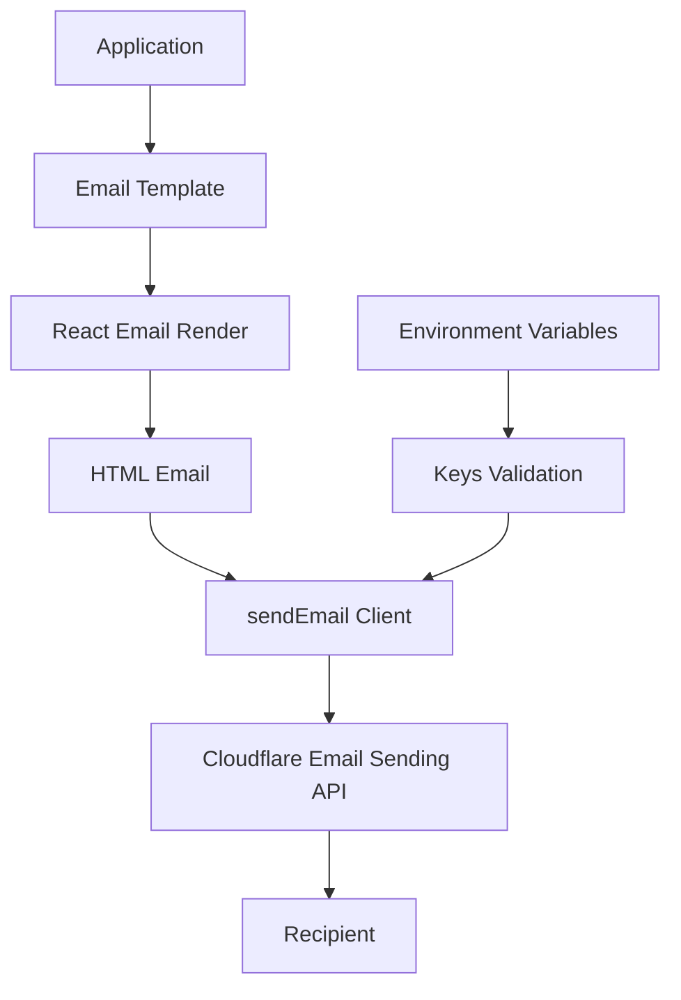

# @gabfon/email Architecture

## Overview

The `@gabfon/email` package provides a comprehensive email solution built on React Email and the Cloudflare Email Sending API. It offers a template-based approach for creating and sending emails with type-safe environment configuration and reusable React components.

## Architectural Decisions

### 1. React Email Integration

- **Decision**: Use React Email for template creation with JSX
- **Rationale**: Leverages React component patterns for email templates
- **Implementation**: Email templates as React components rendered with `@react-email/render`

### 2. Cloudflare Email Sending as Email Provider

- **Decision**: Use the Cloudflare Email Sending REST API
- **Rationale**: Runs on the same Cloudflare platform the site deploys to; no third-party SDK, plain `fetch` against a single endpoint
- **Implementation**: A thin `sendEmail` client that posts to `POST /accounts/{account_id}/email/sending/send` with a Bearer API token

### 3. Template-Based Architecture

- **Decision**: Organize email templates as reusable components
- **Rationale**: Promotes consistency and reusability across email types
- **Implementation**: Templates directory with component-based templates

### 4. Environment-Driven Configuration

- **Decision**: Use `@t3-oss/env-nextjs` for type-safe environment variables
- **Rationale**: Ensures email configuration is validated at runtime
- **Implementation**: Centralized key management with Zod validation

### 5. Graceful Degradation

- **Decision**: Reading config is lazy; `sendEmail` rejects when unconfigured
- **Rationale**: Importing the package never throws, so the site runs (and its best-effort notifications degrade) in environments without email credentials
- **Implementation**: `EMAIL_*` vars are read at call time; a missing config rejects with an `EmailSendError` of code `0`

## Module Organization

```
src/
├── templates/          # Email template components
│   └── contact.tsx   # Contact form email template
├── keys.ts            # Environment variable validation
└── index.ts           # Cloudflare Email Sending client (sendEmail, etc.)
```

## Data Flow



## Key Dependencies

### Core Email

- **`@react-email/components`**: React Email component library
- **`@react-email/render`**: React Email HTML rendering
- **`fetch`**: Cloudflare Email Sending API transport (no SDK dependency)

### React Dependencies

- **`react`**: Email template components

### Configuration Dependencies

- **`@t3-oss/env-nextjs`**: Environment variable validation
- **`zod`**: Runtime type validation

## Template Architecture

### Email Template Structure

```typescript
// Template component interface
interface EmailTemplateProps {
  // Template-specific props
  recipient: string;
  subject?: string;
  data: Record<string, unknown>;
}

// Template component
export function EmailTemplate({ recipient, data }: EmailTemplateProps) {
  return (
    <Html>
      <Head />
      <Preview>Email preview text</Preview>
      <Body style={main}>
        <Container>
          <Section>
            {/* Email content */}
          </Section>
        </Container>
      </Body>
    </Html>
  );
}
```

### Template Patterns

#### 1. Base Template Pattern

```typescript
// Base template with common layout
export function BaseTemplate({ children, ...props }) {
  return (
    <Html>
      <Head />
      <Body>
        <Container>
          <Header />
          {children}
          <Footer />
        </Container>
      </Body>
    </Html>
  );
}
```

#### 2. Specific Template Pattern

```typescript
// Specific template extending base
export function ContactTemplate({ data }) {
  return (
    <BaseTemplate>
      <Section>
        <Text>Name: {data.name}</Text>
        <Text>Email: {data.email}</Text>
        <Text>Message: {data.message}</Text>
      </Section>
    </BaseTemplate>
  );
}
```

## Client Architecture

### Cloudflare Email Sending Client

A minimal `fetch`-based client over the Cloudflare Email Sending REST API. Config is read lazily from `process.env` so the import never throws:

```typescript
import { render } from "@react-email/render";

export async function sendEmail(
  options: SendEmailOptions
): Promise<SendEmailResult> {
  const account = process.env.EMAIL_ACCOUNT_ID;
  const token = process.env.EMAIL_API_TOKEN;
  const defaultFrom = process.env.EMAIL_FROM;

  if (!account || !token || !defaultFrom) {
    throw new EmailSendError(
      0,
      [],
      "Cloudflare Email Sending is not configured"
    );
  }

  const response = await fetch(
    `https://api.cloudflare.com/client/v4/accounts/${account}/email/sending/send`,
    {
      method: "POST",
      headers: {
        Authorization: `Bearer ${token}`,
        "Content-Type": "application/json",
      },
      body: JSON.stringify(
        /* to, from, subject, text, html, cc, bcc, reply_to, headers */
      ),
    }
  );

  // Non-2xx or success === false -> throws EmailSendError(status, codes, detail)
  // 2xx -> returns { messageId, delivered, queued, permanentBounces, suppressedRecipients }
}
```

### Environment Configuration

```typescript
export const keys = () =>
  createEnv({
    server: {
      EMAIL_ACCOUNT_ID: z.string().min(1),
      EMAIL_FROM: z.email(),
      EMAIL_API_TOKEN: z.string().min(1),
    },
    runtimeEnv: {
      EMAIL_ACCOUNT_ID: process.env.EMAIL_ACCOUNT_ID,
      EMAIL_FROM: process.env.EMAIL_FROM,
      EMAIL_API_TOKEN: process.env.EMAIL_API_TOKEN,
    },
    emptyStringAsUndefined: true,
    skipValidation: !!process.env.SKIP_ENV_VALIDATION,
  });
```

## Integration Patterns

### 1. Template Usage

```typescript
import { sendEmail } from '@gabfon/email';
import { ContactTemplate } from '@gabfon/email/templates/contact';

async function sendContactEmail(data: ContactData) {
  await sendEmail({
    to: data.recipient,
    subject: 'New Contact Form Submission',
    react: <ContactTemplate data={data} />,
  });
}
```

### 2. API Route Integration

```typescript
// app/api/contact/route.ts
import { sendEmail } from '@gabfon/email';
import { ContactTemplate } from '@gabfon/email/templates/contact';

export async function POST(request: Request) {
  const data = await request.json();

  await sendEmail({
    to: 'admin@example.com',
    subject: 'New Contact Form Submission',
    react: <ContactTemplate data={data} />,
  });

  return Response.json({ success: true });
}
```

### 3. Server Action Integration

```typescript
// actions/contact.ts
'use server';

import { sendEmail } from '@gabfon/email';
import { ContactTemplate } from '@gabfon/email/templates/contact';

export async function sendContactEmail(data: ContactData) {
  try {
    await sendEmail({
      to: 'admin@example.com',
      subject: 'New Contact Form Submission',
      react: <ContactTemplate data={data} />,
    });

    return { success: true };
  } catch (error) {
    return { success: false, error: error.message };
  }
}
```

## Security Considerations

### 1. Environment Variable Security

- `EMAIL_API_TOKEN` validated at runtime
- Token never exposed to client-side code (server-only `fetch` calls)
- Proper error handling for missing configuration

### 2. Content Security

- HTML built from templates, not raw user input
- User-supplied text is sent as plain text or escaped template props
- Proper email header configuration

### 3. Rate Limiting

- Integration with rate limiting package
- API endpoint protection
- Email sending limits

## Performance Optimizations

### 1. Template Rendering

- Server-side rendering for email templates
- Template caching for repeated sends
- Optimized HTML generation

### 2. Email Delivery

- Batch sending via `Promise.allSettled`
- Per-recipient status surfaced from the API response

### 3. Bundle Optimization

- Tree-shaking for unused templates
- No third-party email SDK to ship
- Server-side only dependencies

## Testing Strategy

### 1. Template Testing

- Visual testing of email rendering
- Cross-client compatibility testing
- Responsive design verification

### 2. Integration Testing

- End-to-end email sending against a stubbed `fetch`
- API route testing
- Error handling verification

### 3. Unit Testing

- Template component testing
- Environment validation testing
- Client request/response handling testing (URL, auth header, body, error mapping)

## Environment Configuration

### Required Variables

| Variable | Description | Type | Required |
| --- | --- | --- | --- |
| `EMAIL_ACCOUNT_ID` | Cloudflare account ID | string | Yes |
| `EMAIL_FROM` | Verified default from email address | email | Yes |
| `EMAIL_API_TOKEN` | Cloudflare API token (Send permission) | string | Yes |

### Validation Rules

- `EMAIL_FROM`: Must be valid email format
- `EMAIL_ACCOUNT_ID` / `EMAIL_API_TOKEN`: Must be non-empty strings
- All variables are server-side only

## Error Handling

### Environment Validation Errors

```typescript
try {
  const env = keys();
  // Use environment variables
} catch (error) {
  console.error("Email configuration error:", error);
  // Handle missing or invalid environment variables
}
```

### Email Sending Errors

```typescript
import { sendEmail, EmailSendError } from "@gabfon/email";

try {
  await sendEmail(emailData);
} catch (error) {
  if (error instanceof EmailSendError) {
    // error.status -> HTTP status (0 when unconfigured)
    // error.codes  -> Cloudflare API error codes
    console.error("Email sending error:", error.message);
  }
}
```

## Future Extensibility

The architecture supports:

- Additional sending transports behind `sendEmail`
- Template inheritance and composition
- Email analytics and tracking
- Automated email campaigns
- Email template management system
- Multi-language email support

## Migration Path

The package is designed to support:

- Easy transport switching (the send layer is isolated in `index.ts`)
- Gradual template migration
- Backward compatibility maintenance
- Versioned template releases
- Email service abstraction
